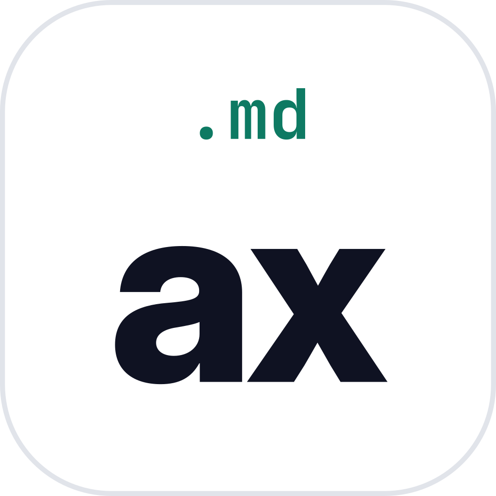

# axiomic brand assets

Everything is vector-outlined: the lettering is real shapes, not live text, so the files look the same on every machine and need no fonts installed.

"Dark" and "light" mean the theme the asset is made for:
- **dark** = use on dark backgrounds / dark mode (night tile, white letters)
- **light** = use on light backgrounds / light mode (white tile, ink letters)

## What to use where

| Need | File |
|---|---|
| Website nav logo (light theme) | `logo/svg/axiomic-logo-on-light.svg` |
| Website nav logo (dark theme) | `logo/svg/axiomic-logo-on-dark.svg` |
| Name only, light backgrounds | `wordmark/svg/axiomic-wordmark-ink.svg` |
| Name only, dark backgrounds | `wordmark/svg/axiomic-wordmark-white.svg` |
| Icon only | `icon/svg/axiomic-icon-light.svg`, `icon/svg/axiomic-icon-dark.svg` |
| Icon at 48px or smaller | `icon/svg/axiomic-icon-*-small.svg` (big ax, mint bar instead of .md) |
| Browser tab (favicon) | everything in `favicon/` (see below) |
| macOS app / Dock | `app/macos/axiomic.icns` (source: `axiomic-macos-1024.png`) |
| Windows app / taskbar | `app/windows/axiomic.ico` (16 to 256px inside) |
| Link previews (Slack, X, LinkedIn) | `social/axiomic-og-1200x630.png` |
| Colours for CSS | `tokens/colors.css`, `tokens/tokens.json` |

Prefer the SVGs on the website. Use the PNGs where SVG isn't accepted (emails, some CMSs, app stores).

## Building the nav

Icon and name are separate files so you can place them yourself:

```html
<a href="/" class="brand">
  
  
</a>
```

```css
.brand { display: inline-flex; align-items: center; gap: 9px; }
```

Proportions: icon 30px, name 22px tall, 9px gap. Scale all three together. Swap to the `dark` icon and the `white` wordmark in dark mode, or use the ready-made lockups in `logo/`.

## Favicon

Copy the contents of `favicon/` to your site root and paste `favicon/head-snippet.html` into `<head>`. `favicon.svg` switches between light and dark automatically with the visitor's system theme.

## Sizes included

- Icon PNG: 64, 128, 256, 512, 1024 (plus small version at 16, 24, 32, 48), both themes
- Wordmark PNG heights: 24, 32, 48, 64, 96, 128, 256, 512, white and ink
- Logo PNG heights: 32, 48, 64, 128, 256, 512, both themes
- Web app: apple-touch-icon 180, android-chrome 192 and 512, maskable 512

## Colours

| Name | Hex |
|---|---|
| Night (top to bottom) | `#22263A` to `#07080F` |
| Mint | `#7CF0D2` |
| Deep green | `#0E7A63` |
| Ink | `#0F1222` |
| White | `#FFFFFF` |
| Border (light icon) | `#E1E4EA` |

## Type

- Wordmark and "ax": Inter Tight or Inter Display, ExtraBold 800, tracking about -3%
- ".md": JetBrains Mono, Bold

The outlines in these files were drawn from Inter Display ExtraBold and JetBrains Mono Bold. On the website itself, use Inter Tight 800 for any text set to match.

## Don't

- Don't recolour, stretch or add effects to the icon.
- Don't rebuild the name in a different font. Use the wordmark files.
- Keep clear space around the logo of at least half the icon's height.
